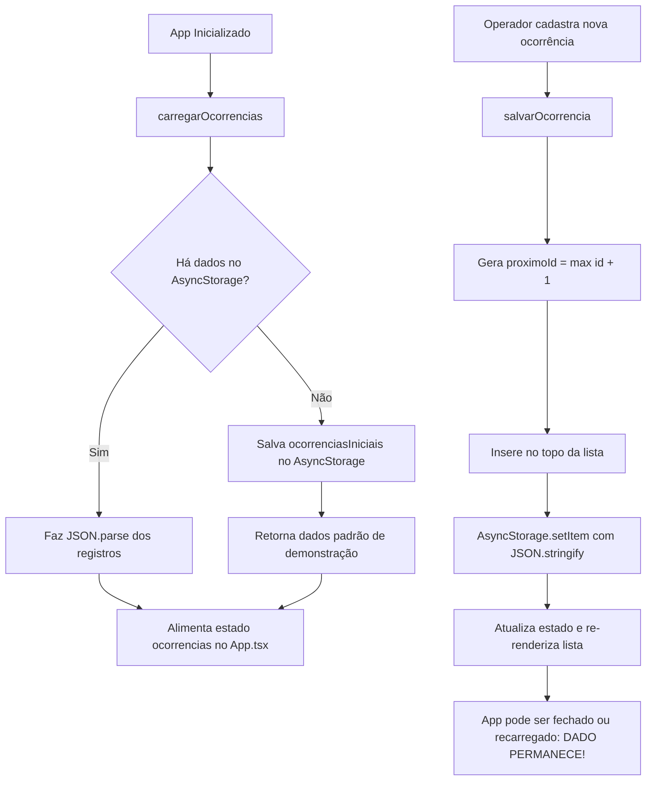

# 📱 Motiva — Gestão e Monitoramento de Ocorrências Operacionais
## Sprint 4 — Entrega Final (Documentação e Demonstração Técnica)
### Challenge 2026 • FIAP • Cross Platform Application Development

[](https://reactnative.dev/)
[](https://expo.dev/)
[](https://www.typescriptlang.org/)
[](https://react-native-async-storage.github.io/async-storage/)
[]()
[]()

---

## 👥 Integrantes do Grupo

| Nome Completo | RM | Responsabilidade Principal |
|---|:---:|---|
| **Pedro Henrique Souza Barreto** | **564437** | Documentação, Estrutura de Tipos e Validações |
| **Filippo Picino Mendez** | **565994** | Arquitetura Cross-Platform, Telas e Componentização |
| **Pam Mitchell Barbosa Durham** | **562635** | Persistência com AsyncStorage e Fluxo de Ocorrências |
| **Gustavo Henrique Rodovalho Silva** | **563695** | Roteiro de Demonstração, Testes de Usabilidade e Vídeo |

🔗 **Link do Repositório GitHub:** [https://github.com/Filippohh/CROSS-PLATAFORM-APPLICATION-DEVELOPMENT](https://github.com/Filippohh/CROSS-PLATAFORM-APPLICATION-DEVELOPMENT)  
📺 **Link do Vídeo no YouTube (Não Listado):** [https://youtu.be/SEU_LINK_AQUI](https://youtu.be/SEU_LINK_AQUI) *(substitua pelo link após a gravação)*

---

## 🎯 1. O Problema da Motiva, Usuário e Ação Principal

### 1.1 Contexto e Problema Operacional
A **Motiva** (concessionária do grupo CCR responsável por rodovias e pátios de custódia veicular) lida diariamente com centenas de quilômetros de malha viária e extensas áreas de pátios operacionais. Nesses ambientes críticos, anomalias e incidentes como:
- Vegetação densa obstruindo a visualização de placas de trânsito regulamentares;
- Vazamento de combustível ou fluidos em veículos apreendidos nos pátios;
- Danos a cercas perimetrais, defensas metálicas e pavimentação;
- Risco iminente de focos de incêndio em áreas secas durante estiagem.

Historicamente, o relato dessas situações ocorria por anotações manuais em pranchetas ou canais informais de mensagens, ocasionando lentidão no despacho das equipes de socorro/manutenção e perda do histórico para auditorias da ARTESP.

### 1.2 O Usuário-Alvo
- **Operadores de Campo e Fiscais de Pátio:** Profissionais em ronda que necessitam de uma ferramenta móvel ágil, simples e de baixa fricção para registrar o problema no exato momento em que ele é detectado.
- **Supervisores de Centro de Controle Operacional (CCO):** Responsáveis por visualizar o painel geral, identificar a severidade/risco de cada incidente e despachar a intervenção apropriada (imediata, programada ou monitoramento preventivo).

### 1.3 A Ação Principal do Aplicativo
Permitir que o operador em campo:
1. Abra o app e veja o **status consolidado** e a lista de ocorrências já cadastradas;
2. Realize o **cadastro imediato** de uma nova ocorrência (descrevendo o problema, informando a localização física e classificando o nível de risco);
3. Consulte o **detalhe completo** de qualquer ocorrência registrada com instruções automáticas de protocolo de segurança;
4. Conte com **persistência total e transparente dos dados localmente no aparelho**, garantindo que as ocorrências permaneçam salvas mesmo fechando, suspendendo ou recarregando o aplicativo.

---

## 🛠️ 2. Stack Tecnológica

O projeto foi construído respeitando integralmente as diretrizes da disciplina **Cross Platform Application Development**:

| Tecnologia | Versão | Motivação e Aplicação no Projeto |
|---|:---:|---|
| **React Native** | `0.83.2` | Framework nativo para geração de componentes móveis universais (iOS e Android) com desempenho de alto nível. |
| **Expo** | `~55.0.5` | Plataforma moderna de desenvolvimento e tooling (Expo CLI, Metro Bundler, Hot Reloading e preview via Expo Go). |
| **TypeScript** | `~5.9.2` | Tipagem estática rigorosa (`strict: true`), garantindo integridade dos contratos de dados e prevenção de bugs em tempo de compilação. |
| **@react-native-async-storage/async-storage** | `^2.1.2` | Camada de persistência relacional/chave-valor nativa assíncrona, desacoplada e resiliente. |
| **React Native Web** | `^0.21.0` | Suporte cross-platform instantâneo para execução e testes via navegador web desktop. |

---

## 📂 3. Estrutura de Pastas do Projeto

A organização dos diretórios prioriza alta coesão, separação estrita de responsabilidades e fácil manutenção:

```text
motiva-ocorrencias-app/
│
├── assets/                          # Recursos gráficos (ícones, splash screens, favicons)
│   ├── icon.png
│   ├── splash-icon.png
│   ├── favicon.png
│   └── android-icon-foreground.png
│
├── src/                             # Código-fonte principal da aplicação
│   │
│   ├── types/                       # Definições de tipagem estrita TypeScript
│   │   └── ocorrencia.ts            # Tipos centrais Ocorrencia e Risco ('baixo' | 'medio' | 'alto')
│   │
│   ├── data/                        # Dados iniciais para inicialização do sistema
│   │   └── ocorrenciasIniciais.ts   # Registros mock realistas da Motiva (CCR)
│   │
│   ├── storage/                     # Camada de abstração de persistência no dispositivo
│   │   └── ocorrenciasStorage.ts    # Funções de carregar, salvar e persistir via AsyncStorage
│   │
│   ├── components/                  # Componentes visuais reutilizáveis
│   │   ├── OcorrenciaCard.tsx       # Card interativo de exibição resumida na listagem
│   │   └── RiscoBadge.tsx           # Badge visual com cor, borda e ponto indicador por severidade
│   │
│   └── screens/                     # Telas completas que compõem o fluxo do aplicativo
│       ├── ListaOcorrenciasScreen.tsx    # Painel principal: estatísticas, contadores e lista de cards
│       ├── CadastroOcorrenciaScreen.tsx # Formulário de criação com validação e seletor de risco
│       ├── DetalheOcorrenciaScreen.tsx  # Visão minuciosa com protocolo e confirmação de persistência
│       └── index.ts                 # Exportador consolidado das telas
│
├── App.tsx                          # Orquestrador central: estados de navegação, SafeAreaView e StatusBar
├── index.ts                         # Ponto de entrada do runtime Expo (registerRootComponent)
├── app.json                         # Configurações do ecossistema Expo (slug, orientação, cores)
├── tsconfig.json                    # Configurações do compilador TypeScript com modo strict ativado
├── package.json                     # Metadados do projeto, scripts de inicialização e dependências
└── README.md                        # Guia oficial de documentação, arquitetura e demonstração
```

---

## 🧱 4. O Tipo `Ocorrencia` e Onde é Usado

O modelo de dados central do aplicativo está definido no arquivo [`src/types/ocorrencia.ts`](src/types/ocorrencia.ts):

```typescript
export type Risco = 'baixo' | 'medio' | 'alto';

export type Ocorrencia = {
  id: number;          // Identificador numérico único sequencial
  descricao: string;   // Texto descritivo da anomalia identificada
  local: string;       // Pátio, rodovia, km ou setor físico
  risco: Risco;        // Nível de severidade operacional padronizado
  data: string;        // Data do registro em padrão ISO YYYY-MM-DD
};
```

### Onde o tipo `Ocorrencia` é utilizado no projeto:
1. **`src/types/ocorrencia.ts`:** Fonte única da verdade (*Single Source of Truth*), definindo `Risco` e `Ocorrencia`.
2. **`src/data/ocorrenciasIniciais.ts`:** Tipagem da coleção padrão de demonstração (`Ocorrencia[]`).
3. **`src/storage/ocorrenciasStorage.ts`:** Contrato de retorno da função `carregarOcorrencias(): Promise<Ocorrencia[]>` e do parâmetro `nova: Omit<Ocorrencia, 'id'>` na função `salvarOcorrencia()`.
4. **`src/components/RiscoBadge.tsx`:** Recebe a propriedade `risco: Risco` para mapear dinamicamente estilos, cores de contraste e textos.
5. **`src/components/OcorrenciaCard.tsx`:** Recebe `ocorrencia: Ocorrencia` via Props para renderização na lista.
6. **`src/screens/ListaOcorrenciasScreen.tsx`:** Recebe `ocorrencias: Ocorrencia[]` para alimentar a `FlatList` e calcular contadores estatísticos em tempo real.
7. **`src/screens/CadastroOcorrenciaScreen.tsx`:** Constrói o payload tipado `Omit<Ocorrencia, 'id'>` a partir dos dados preenchidos no formulário.
8. **`src/screens/DetalheOcorrenciaScreen.tsx`:** Recebe `ocorrencia: Ocorrencia` para renderizar o cartão individual detalhado e a ação de protocolo correspondente.
9. **`App.tsx`:** Mantém o estado global da aplicação `useState<Ocorrencia[]>([])` e localiza itens para detalhamento com `ocorrencias.find()`.

---

## 💾 5. Como os Dados São Persistidos (AsyncStorage)

A persistência do aplicativo é implementada de forma desacoplada no módulo [`src/storage/ocorrenciasStorage.ts`](src/storage/ocorrenciasStorage.ts), utilizando o pacote oficial `@react-native-async-storage/async-storage`.

### 5.1 Chave de Armazenamento
Os dados são armazenados sob a chave identificada:
```typescript
const STORAGE_KEY = '@motiva:ocorrencias_v1';
```

### 5.2 Ciclo de Vida da Persistência



### 5.3 Implementação Técnica
- **Leitura Segura (`carregarOcorrencias`):** Realiza `AsyncStorage.getItem(STORAGE_KEY)`. Se houver conteúdo prévio, desserializa via `JSON.parse`. Caso contrário (primeira execução), armazena a base inicial e garante que a lista nunca inicie quebrada ou vazia.
- **Gravação Atômica (`salvarOcorrencia`):** Calcula o próximo identificador incremental (`id = Math.max(...) + 1`), combina a nova ocorrência com a coleção existente e serializa com `JSON.stringify()`.
- **Garantia de Permanência:** Qualquer ocorrência inserida fica gravada no armazenamento persistente do dispositivo ou local storage do browser. Ao fechar completamente o app e reabri-lo, ou dar F5 na versão web, todas as novas ocorrências permanecem listadas.

---

## 🚀 6. Como Rodar o Projeto

### Pré-requisitos
- **Node.js** versão 18 ou superior instalada (verifique com `node -v`);
- Gerenciador de pacotes **npm** (incluso com o Node);
- Opcional: aplicativo **Expo Go** instalado no seu smartphone físico (Android ou iOS).

### Passo a Passo

1. **Abra o terminal** na pasta do projeto:
   ```bash
   cd "Sprint 4 - CROSS PLATFORM APPLICATION DEVELOPMENT"
   ```

2. **Instale as dependências:**
   ```bash
   npm install
   ```

3. **Inicie o servidor de desenvolvimento Expo:**
   ```bash
   npx expo start
   ```

4. **Escolha como deseja visualizar:**
   - **No navegador Desktop (Web):** Pressione a tecla `w` no terminal (abrirá automaticamente em `http://localhost:8081`).
   - **No celular físico (Expo Go):** Abra a câmera do seu celular (iOS) ou o aplicativo Expo Go (Android) e escaneie o QR Code exibido no terminal.
   - **No emulador Android:** Pressione a tecla `a` no terminal (requer Android Studio configurado).
   - **No simulador iOS:** Pressione a tecla `i` no terminal (requer macOS com Xcode).

---

## 📱 7. Comportamento Esperado da Aplicação

O aplicativo cumpre rigorosamente todos os requisitos funcionais solicitados para a Sprint 3 e Sprint 4:

| Etapa | Comportamento Observável |
|---|---|
| **1. Abertura do App** | O aplicativo carrega suavemente exibindo o topo escuro corporativo da Motiva, os cards com estatísticas de risco (Total, Alto, Médio, Baixo) e a listagem inicial de ocorrências pré-persistidas. |
| **2. Criar Nova Ocorrência** | Ao tocar no botão verde **"+ Nova"**, o app transiciona para o formulário. O usuário digita a descrição, o local físico e seleciona com 1 toque o risco (**Baixo**, **Médio** ou **Alto**). Há validação em tempo real impedindo envio com campos em branco. |
| **3. Visualizar na Lista** | Ao tocar em **"Salvar Ocorrência"**, os dados são persistidos no AsyncStorage e o app retorna para a lista. A nova ocorrência surge imediatamente no topo com seu identificador sequencial (ex: `#004`), local, data e badge colorido. |
| **4. Abrir Detalhe** | Ao tocar sobre qualquer card de ocorrência na lista, abre-se a tela de **Detalhes da Ocorrência**, exibindo a identificação completa, descrição em texto integral, localização, badge ampliado, protocolo de ação da Motiva e confirmação de persistência no dispositivo. |
| **5. Fechar e Reabrir o App** | Feche a aba do navegador ou encerre a execução do Expo Go e reabra novamente. Todas as ocorrências cadastradas continuam salvas e visíveis no aplicativo, comprovando a **persistência com AsyncStorage**. |

---

## 🎨 8. Classificação de Risco na Lista e no Detalhe

Para garantir leitura instantânea e conformidade com as normas de segurança rodoviária, as ocorrências recebem classificação cromática padronizada:

```
┌─────────┬──────────────┬──────────────┬──────────────┬────────────────────────────────────────────────────────┐
│  Nível  │  Cor Fundo   │  Cor Borda   │  Cor Texto   │ Protocolo Operacional da Motiva                        │
├─────────┼──────────────┼──────────────┼──────────────┼────────────────────────────────────────────────────────┤
│  ALTO   │  #FEE2E2     │  #FCA5A5     │  #991B1B     │ Acionamento imediato da equipe de campo.               │
│         │  (Vermelho)  │  (Alerta)    │  (Crítico)   │ Prioridade máxima na fila do Centro de Operações.      │
├─────────┼──────────────┼──────────────┼──────────────┼────────────────────────────────────────────────────────┤
│  MÉDIO  │  #FEF3C7     │  #FCD34D     │  #92400E     │ Inspeção técnica presencial programada em 24h.         │
│         │  (Amarelo)   │  (Âmbar)     │  (Alerta)    │ Registro compartilhado para monitoramento preventivo.  │
├─────────┼──────────────┼──────────────┼──────────────┼────────────────────────────────────────────────────────┤
│  BAIXO  │  #DCFCE7     │  #86EFAC     │  #166534     │ Registro para manutenção e conservação periódica       │
│         │  (Verde)     │  (Suave)     │  (Rotina)    │ no cronograma regular de serviços.                     │
└─────────┴──────────────┴──────────────┴──────────────┴────────────────────────────────────────────────────────┘
```

- **Na Lista:** Cada card exibe a `RiscoBadge` compacta no canto superior direito, e a barra superior do app contabiliza em tempo real a quantidade de ocorrências em cada um dos 3 níveis.
- **No Detalhe:** O badge aparece em tamanho ampliado no topo e um bloco colorido específico detalha a diretriz de atendimento correspondente àquela criticidade.

---

## 🎥 9. Roteiro do Vídeo de Demonstração (YouTube — Não Listado, até 5 min)

O vídeo atende 100% dos requisitos de avaliação da Sprint 4 (35 pontos da rubrica). Abaixo está o roteiro cronometrado preparado para ser seguido durante a gravação:

```text
========================================================================================
ROTEIRO DE GRAVAÇÃO DO VÍDEO (DURAÇÃO MÁXIMA: 5 MINUTOS)
========================================================================================

[00:00 - 00:45] APRESENTAÇÃO DO GRUPO E DO README
• Abra a tela no navegador exibindo este README no GitHub.
• Apresente os integrantes: Pedro Barreto, Filippo Picino, Pam Durham e Gustavo Rodovalho.
• Explique brevemente o problema:
  "O aplicativo da Motiva foi desenvolvido para resolver o desafio de registro ágil de
  ocorrências em rodovias e pátios de custódia veicular. Ele substitui processos manuais
  e permite que o operador de campo reporte anomalias com classificação imediata de risco."

[00:45 - 01:30] SUBINDO O EXPO E APRESENTANDO A LISTA INICIAL
• Mostre o terminal executando:
  npm install (já executado)
  npx expo start
• Pressione 'w' e abra o app no navegador (ou exiba na tela do celular via Expo Go).
• Mostre o cabeçalho "Ocorrências em Pátios e Rodovias" e a barra de estatísticas
  (Total, Alto, Médio, Baixo).
• Mostre os cards carregados inicialmente da base mock.

[01:30 - 02:45] CADASTRO DE UMA NOVA OCORRÊNCIA EM TEMPO REAL
• Clique no botão verde "+ Nova".
• Mostre o formulário limpo e explique a validação:
  - Tente clicar em "Salvar" sem digitar nada para mostrar a mensagem de validação:
    "Informe uma descrição clara para a ocorrência."
• Preencha dados reais de demonstração:
  - Descrição: "Cabo de iluminação rompido próximo ao portão de acesso principal"
  - Local: "Pátio Motiva Anhanguera - Portaria 2"
  - Risco: Selecione "Alto" (mostre o botão ficando vermelho com borda destacada).
• Clique em "Salvar Ocorrência".

[02:45 - 03:30] EXIBIÇÃO NA LISTA E ABERTURA DO DETALHE
• Mostre que o app retornou para a lista e a nova ocorrência (#004) já aparece no topo!
• Aponte que o contador de risco "Alto" aumentou em tempo real.
• Clique sobre o card recém-criado para abrir a tela de Detalhes.
• Mostre o ID #004, o badge "Risco Alto", a descrição, a localização com ícone,
  a data do dia e o bloco explicativo com o protocolo de emergência da Motiva.
• Clique em "← Voltar para lista".

[03:30 - 04:30] PROVA TÉCNICA DE PERSISTÊNCIA (ASYNCSTORAGE)
• Explique:
  "Agora vamos comprovar a persistência de dados solicitada na Sprint 3 e Sprint 4.
  Os dados não estão apenas em memória temporária: eles foram serializados e gravados
  no armazenamento do dispositivo via AsyncStorage sob a chave @motiva:ocorrencias_v1."
• Recarregue a página (pressione F5 no navegador) ou encerre e reabra a aba/app.
• Mostre que a aplicação carrega e o registro #004 continua exatamente lá, intacto!

[04:30 - 05:00] ENCERRAMENTO E CONCLUSÃO
• Finalize reforçando que o fluxo principal está 100% estável, sem telas quebradas,
  utilizando TypeScript rigoroso, React Native e Expo SDK 55.
• Agradeça ao professor e finalize a gravação.
========================================================================================
```

> [!IMPORTANT]
> **Atenção:** Ao subir o vídeo no YouTube, selecione a visibilidade **"Não listado"** (Unlisted). Vídeos privados não podem ser assistidos pelo professor e resultarão em nota zero no critério de demonstração.

---

## 🏆 10. Critérios de Avaliação Atendidos

| Critério Avaliado | Pontuação | Como foi Atendido neste Projeto |
|---|:---:|---|
| **App final estável (fluxo da Sprint 3)** | **30 pts** | Aplicação completa com lista, cadastro, detalhe, classificação visual de risco e persistência local, sem nenhuma tela quebrada no fluxo principal. |
| **README claro (execução e comportamento)** | **35 pts** | Documentação completa com dados dos integrantes, instruções de execução, diagrama de arquitetura, contrato do tipo `Ocorrencia` e tabela de cores. |
| **Vídeo demonstrativo (até 5 min)** | **35 pts** | Roteiro estruturado cobrindo a abertura do README, subida do Expo, criação, consulta, demonstração prática da persistência com F5/reabertura e encerramento. |
| **Total** | **100 pts** | **Atendimento integral a todas as exigências do Challenge.** |
